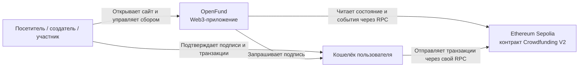
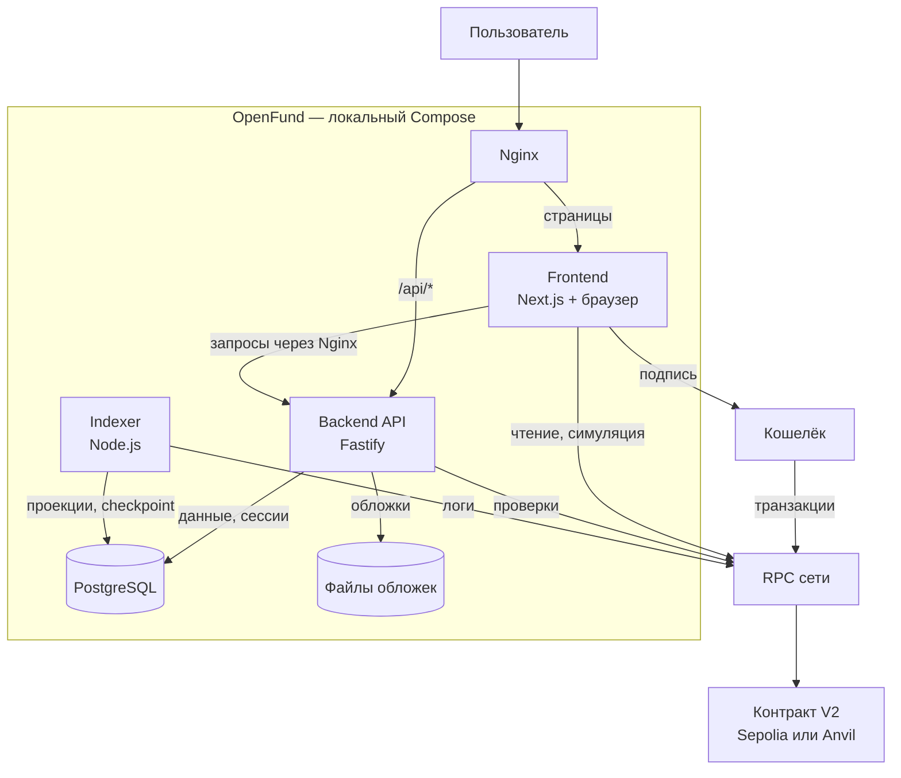
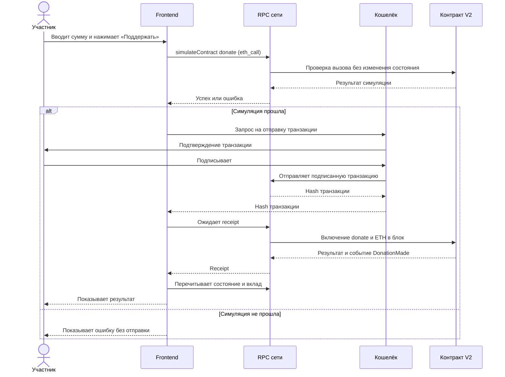
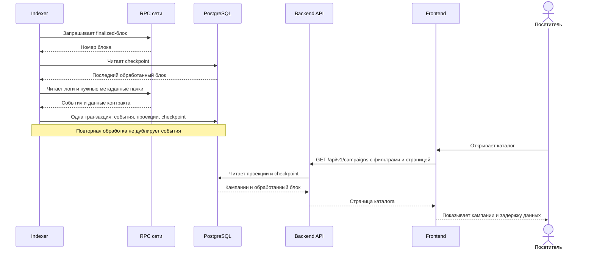
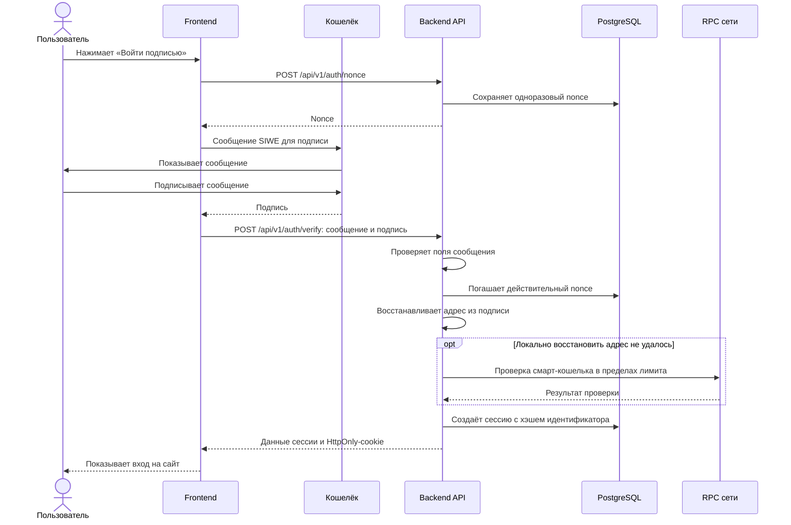

# Диаграммы OpenFund

Диаграммы показывают текущую реализацию. Они написаны на Mermaid и отображаются в GitHub; подробности и ограничения находятся в [архитектуре](architecture.md), а адреса контракта — в [deployment](deployments.md).

## Контекст системы — C4, уровень 1

В локальном демо вместо Sepolia используется Anvil и тестовые роли; транзакции отправляются в локальную сеть. Это альтернативный режим той же системы, а не связь с реальными средствами.

## Контейнеры — C4, уровень 2

В диаграмме frontend включает сервер Next.js и код в браузере. В основном режиме кошелёк отправляет транзакцию через настроенный в нём RPC. В демо роль использует локальный Anvil; кошелёк-расширение не требуется. PostgreSQL и медиа — отдельные хранилища; доступные пользователю суммы и условия окончательно определяет контракт.

## Пожертвование

Событие становится доступно каталогу и ленте после обработки индексатором. Кошелёк может отклонить подпись, а транзакция — завершиться ошибкой уже после симуляции.

## Индексация и каталог

Indexer обрабатывает данные только до `finalized`, поэтому каталог может отставать от последних транзакций. При недоступности backend каталог может читать страницу из контракта с ограниченными фильтрами.

## Вход подписью SIWE

Подпись сообщения не отправляет транзакцию и не расходует газ. На диаграмме показан успешный путь; ошибки проверки не создают сессию, а nonce используется однократно.
